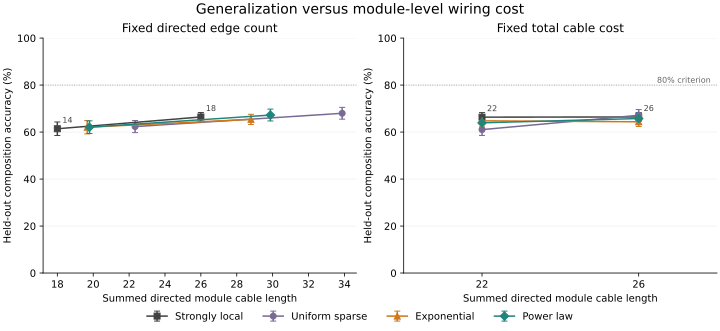

# Module-level compositional generalization

This protocol supersedes the **invalid two-module pilot** below. The original
`composition_*` artifacts are removed from the current tree and preserved in Git
history at `5bdc38d`; commits `51a2315`, `7cc1986`, `5bdc38d` remain intact.
Their parity-confounded holdouts, neuron-level geometry, absent communicating
specialization, and global max readout prevent testing the present hypothesis.
They are historical diagnostics, not confirmatory evidence. No history is rewritten.

## Hypothesis and scope

An intermediate, sparse, distance-dependent **module graph** may preserve source
specialization while enabling cooperation and improve held-out composition by at
least five percentage points relative to both strongly local and uniform controls.
The tested grid has exponential and power-law shortcut rules, two edge budgets,
and two exact total cable-cost budgets. A cost-matched benefit would support a
better generalization/wiring tradeoff in this grid. Existence outside this grid,
biological wiring laws, and general compositional reasoning remain outside scope.

Béna and Goodman, *Dynamics of specialization in neural modules under resource
constraints*, https://doi.org/10.1038/s41467-024-55188-9, motivate restricted
communication, separate inputs, and post-training digit probes. This is an
**empirically gated reduced symbolic experiment**, not a replication of their
MNIST/EMNIST study or their winner-take-all architecture. Their perceptual inputs
and original specialization metrics/sweeps are not reproduced. Do not describe a
passing gate as replication of the original paper.

## Architecture and task

Six modules occupy coordinates `(0,0)` through `(5,0)` on a line. Euclidean module
distance is `abs(i-j)`: distance 1 is local, 2 medium, and 3–5 long-range. Dense
intra-module recurrence is charged identically across conditions and is excluded
from variable inter-module cost. Modules are atomic areas; there are no neuron
coordinates, geometrically cheap neuron swaps, or distance-dependent transmission
latencies. Geometry concerns cable length, not measured physical tissue.

Each module has 24 tanh RNN units. Only module 0 sees digit A and module 5 sees B.
Other modules have no sensory input. A stimulus is a noisy 10-component one-hot
vector per digit, noise SD .05, sampled anew per example and held constant for six
synchronous time steps. Every outgoing module message has **four hard binary
bits**, from a learned hidden-to-message projection. The same message is sent
along each outgoing graph edge; each receiver has its own learned projection.
A sigmoid surrogate derivative trains the threshold (the forward values remain
0/1). There is no analog cross-module route. Biases and local recurrence are
allowed; initial states are zero and independent of the inputs.

The update is `h_i(t+1) = tanh(W_i x_i + R_i h_i(t) + bias_i +
sum_j A_ji C_ji binary(P_j h_j(t)))`. Information traverses at most one graph edge
per time step. **A single linear readout sees only final module 3.** No other
module produces task logits; no max-confidence selection, pooled hidden state,
shared readout, input skip, normalization across examples, or auxiliary digit loss
exists. The implementation uses independent parameter storage and one recurrent
state per module, avoiding the upstream separately evolved core/comms RNN sum.

Reuse the upstream task: output A when A+B is odd, otherwise B. There is no
hand-coded parity, digit relay, curriculum, or digit supervision in training.
Only the ten-way task loss is optimized.

## Splits and controlled budgets

Hold out `(B-A) mod 10` offsets `(1,2)`, `(3,4)`, `(5,6)` respectively. Each test
partition has 20 ordered pairs and its train complement has 80. The test partitions
are mutually disjoint (training partitions overlap, as repeated-measures designs
do). Each partition has equal counts of each digit in both positions, equal counts
of every target label, and exactly half A-selected/half B-selected examples. Each
branch separately covers all ten targets equally. Tests enumerate all 100 pairs
and prove these statements; balanced digits alone are insufficient.

All connected graph conditions share a bidirectional adjacent-module backbone
(five undirected edges). This guarantees routes from both sources to output and
prevents disconnected draws from masquerading as a distance effect. Conclusions
are conditional on this imposed backbone. Additional edges are bidirectional,
without self edges or duplicate edges, selected among the ten nonadjacent pairs.
Before conditioning on budgets, shortcut admissions are independent with priors:

- Strongly local: probability .5 at distance 2 and zero at greater distances.
- Uniform sparse: probability .35 at every candidate distance.
- Exponential: probability `.6 * exp(-.75*(d-2))`.
- Power law: probability `.6 * (d/2)^(-1.5)`.

Enumerate the 1,024 shortcut subsets and sample their Bernoulli likelihoods
**conditional on the exact requested budget**. Thus the *prior* decays with
distance; realized marginal probabilities change under conditioning. Do not claim
independent final edge admissions or isolate distance from degree effects. The
backbone is deterministic; rare long-range shortcuts are the manipulated factor.

Fixed edge counts: **14 or 18 directed module edges**, including the backbone.
Fixed total cable cost: **22 or 26 module-distance units**, summed over directed
edges. A bidirectional edge of length d contributes 2d. Four parallel binary
channels multiply this cable cost by four; both costs are reported. Exact cost
matching can change edge counts and active parameter counts; it controls cable,
not capacity. Fixed-edge comparisons control active connection capacity but allow
cable cost to vary. All conditions allocate the same dense parameters and execute
the same masked operations; active counts are reported separately. These are
complementary estimands, not a claim that capacity and cable are simultaneously
matched. Two budgets per view provide a small, descriptive Pareto comparison.

Also run the bare local chain and a fully disconnected graph as diagnostics, not
matched-budget controls. The disconnected output has no input and must be a
constant prediction with 10% balanced accuracy. A complete graph is used only for
the baseline gate; it is not an extra final condition.

## Baseline validity gate and development disclosure

Exploration used **only full-pair training/evaluation**, never held-out compositions.
A prototype seed 91 checked 2/4/8-bit communication for 2,000 updates. Two-bit
chain communication learned poorly; four-bit chain communication could reach 100%
with strong source specialization. An eight-seed check (1000–1007) found the
four-bit chain less reliable (mean approximately 91% task accuracy), while complete
four-bit graphs learned approximately 99.9%, with own-minus-other source probe
accuracy approximately .275. These are development observations, not final
baseline or topology evidence. The selected 3,000-update design and gate are
frozen before fresh baseline seeds 2000–2007, distinct from final seeds 0–47.

Run full-pair **complete-graph** reference models first, with eight fresh seeds and
identical architecture/training. Also run eight chain diagnostics. Baseline validity
requires complete-reference mean task accuracy >=95%, each branch mean >=95%,
source specialization >=.10, own-digit probe >=.90, and communication-cut drop
>=.20. At least six of eight seeds must individually have task accuracy >=90%
and specialization >=.10. Chain diagnostics do not determine the gate. This gate
establishes cooperation and specialization coexist in this reduced architecture;
it does not establish that every sparse graph is learnable.

The executable refuses **all final topology runs** unless it recomputes this gate
from the complete raw baseline panel and verifies the same frozen source/protocol
hashes and execution revision. No summary flag override is accepted. A failed gate
means revise/replicate the baseline and preregister a new study, without examining
held-out topology outcomes. Baseline results cannot select topology parameters.

## Training, diagnostics, and uncertainty

CPU float32, one thread per model, AdamW lr .003, weight decay 1e-5, norm clipping
1, 3,000 updates, batch 128; no checkpoint selection or early stopping. Training
pairs are sampled uniformly with replacement. Initialization, sampled minibatches,
and noisy stimuli are paired across conditions within seed/split. A separate RNG
controls graphs, shared across splits within seed (splits repeat the same graph).
Complete baseline and chain also share initialization/stimuli. Up to eight worker
processes (default four) accelerate independent jobs without changing per-model compute.

No final held-out evaluation happens during training. Evaluate 100 fresh draws
per pair, macro-average over pairs, and report both branches for seen and held-out
sets. Communication intervention: recompute dynamics on identical inputs while
cutting all outgoing edges, or only outgoing source-A/source-B edges. Parameters,
initial states, readout, and sensory drives remain fixed. Report all-cut held-out
accuracy/drop, each source-cut drop, and the appropriate branch drop. These are
acute interventions on the trained system and can shift the state distribution;
they establish causal dependence, not an optimal retrained-control comparison.
Cuts are forward arguments and do not mutate or retrain the network.

After task training, detach final states from all 100 pairs, fit fixed ridge .01
linear probes with unpenalized intercept on 30 fresh draws per pair, and test on
30 independent draws. Every module is probed for A and B. Probe labels never enter
task training, model selection, or readout. Using held-pair labels for post-training
diagnostics is disclosed. The primary specialization measure is
`[(acc(0,A)-acc(0,B))+(acc(5,B)-acc(5,A))]/1.8`, normalized by chance .1. Also report
all six module probe pairs and mean absolute module preference. Relays/output may
be generalists; source specialization does not establish specialization of every
module, a cognitive role, or nonlinear information absence.

Report total cable and channel cable, edge count, active/allocated parameters,
local/medium/long edge counts, degree spread, clustering, mean shortest path, and
source-to-output hops. The empirical mean performance/cost frontier is descriptive;
it is not an uncertainty-certified Pareto frontier. Exact-cost contrasts provide
the inferential wiring-cost view.

Use **48 independent paired seeds**, with three splits averaged within each seed
before any interval or contrast. Never treat 144 split measurements as independent
replicates. Prospectively assume paired seed SD .08: Student-t nominal 95% interval
half-width is approximately .0232, below the .025 target. If actual variance is
larger, report failed precision and do not add seeds after inspecting results.
Bonferroni simultaneous 95% coverage for 16 planned candidate/control contrasts
has wider intervals (approximately .036 under this SD). This resolves sizable
advantages; it cannot reliably establish a true effect exactly at the five-point
boundary. Report every seed difference, nominal and simultaneous intervals, and
whether nominal half-width meets the target. This is a prospective precision
argument, not retrospective power or a guarantee about observed uncertainty.

## Support, falsification, and inconclusive outcomes

There are eight distance-dependent candidates (two rules x four budget cells).
Compare each to both local and uniform at its identical budget: 16 contrasts.

- Support in this setup requires the baseline gate; candidate mean seen >=.95,
  held >=.80, specialization >=.10, all-cut drop >=.20; and both comparator mean
  seen >=.95. Against **each** control, the point gain must be >=.05 and the
  simultaneous confidence lower bound >0. Report whether support is in the
  fixed-edge or fixed-cost view; only the latter establishes cost-matched benefit.
- Falsify the stated >=5-point advantage **in this tested grid** only if baseline
  passes and every candidate has learned comparators and an upper simultaneous
  bound <.05 against at least one of its two controls. This rejects the required
  advantage over both controls for every tested candidate, not every possible
  topology or the broad biological hypothesis.
- Otherwise inconclusive. Failed baseline, learning, specialization, absolute
  generalization, cooperation, or precision must be reported explicitly. Ancillary
  failure alone cannot establish a precisely falsified topology advantage.

All raw baseline/final runs and exact graph masks are retained as small CSV files;
configurations record splits, protocol, environment, revision and hashes. Summaries
are regenerated from complete raw panels; missing/duplicate/unplanned runs are
rejected. No model/data blobs, hidden tuning, omitted failed seeds, or result-based
selection. Commit protocol/code/tests **before baseline and final runs**. The
baseline/final configs identify that commit. Later changes to numerical code or
thresholds require a disclosed new study; reporting edits may follow results.

## Reproduce

Use the existing pinned Python 3.11.9 environment (`uv sync --locked`). For the
recorded source, check out the revision in `module_baseline_config.json` or
`module_final_config.json` in a separate checkout. Fresh prefixes preserve results.

```sh
uv run --locked python -m unittest -v test_composition
uv run --locked ruff check --isolated dynspec/composition.py test_composition.py
uv run --locked ruff format --isolated --check dynspec/composition.py test_composition.py
uv run --locked python -m dynspec.composition --stage baseline --output reproduced_baseline --workers 4
uv run --locked python -m dynspec.composition --stage final --baseline reproduced_baseline --output reproduced_final --workers 4
git diff --check
```

The pilot artifacts in Git history retain their original meaning and numbers. The
old command without `--stage` now runs the new baseline gate, not the invalid
pilot. To reproduce the pilot, use its historical commit in a separate checkout.
Numerical identity across library versions or machines is not guaranteed.

## Results (2026-10-02)

**The revised experiment falsifies the prespecified >=5-point advantage over both
controls in this tested grid.** This is a threshold-specific result for this
symbolic task, placement, bandwidth and training regime; it does not rule out
smaller gains, other graph parameters, or the broad biological hypothesis.

Protocol and numerical code: **`1bc6af3`**, committed before all fresh baseline and
final runs. All 16 baseline and **2,592 final runs** completed; all failed/poor
performances are retained. No numerical amendments, early stopping, extra seeds,
held-out tuning, or omitted jobs. Final inference uses 48 seed means, each averaging
three splits. The two physical copies of the 18-edge/26-cost local control are
repeated runs, not additional independent evidence.

The preregistered complete-graph baseline gate passed: seen task **99.980%**,
A-selected **99.965%**, B-selected **99.995%**, source specialization **.34389**
(95% seed CI [.31463,.37314]), own probe **96.071%**, other probe **65.121%**, and
all-communication-cut drop **89.971 pp**. The chain baseline diagnostic reached
96.196% overall, but A-selected accuracy was 92.415%; it was not the gate reference.
This establishes the required specialization/cooperation coexistence in the
reduced architecture, not replication of the full perceptual study.

### Complete final panel

| Budget view | Rule | Seen (%) | Held (%) | Source specialization | All-cut drop (pp) | Cable cost | Directed edges |
| --- | --- | ---: | ---: | ---: | ---: | ---: | ---: |
| edges 14 | Strongly local | 97.640 | 61.417 | 0.852 | 51.417 | 18.000 | 14.000 |
| edges 14 | Uniform | 99.257 | 62.338 | 0.629 | 52.338 | 22.333 | 14.000 |
| edges 14 | Exponential | 98.141 | 62.062 | 0.759 | 52.062 | 19.667 | 14.000 |
| edges 14 | Power law | 98.836 | 62.076 | 0.767 | 52.076 | 19.792 | 14.000 |
| edges 18 | Strongly local | 99.985 | 66.430 | 0.730 | 56.430 | 26.000 | 18.000 |
| edges 18 | Uniform | 99.945 | 67.993 | 0.460 | 57.993 | 33.875 | 18.000 |
| edges 18 | Exponential | 99.979 | 65.415 | 0.663 | 55.415 | 28.792 | 18.000 |
| edges 18 | Power law | 99.973 | 67.242 | 0.602 | 57.242 | 29.875 | 18.000 |
| cost 22 | Strongly local | 99.992 | 66.355 | 0.785 | 56.355 | 22.000 | 16.000 |
| cost 22 | Uniform | 99.471 | 61.049 | 0.657 | 51.049 | 22.000 | 14.167 |
| cost 22 | Exponential | 99.871 | 64.786 | 0.765 | 54.786 | 22.000 | 15.750 |
| cost 22 | Power law | 99.845 | 63.937 | 0.748 | 53.937 | 22.000 | 15.583 |
| cost 26 | Strongly local | 99.985 | 66.430 | 0.730 | 56.430 | 26.000 | 18.000 |
| cost 26 | Uniform | 99.697 | 67.154 | 0.593 | 57.154 | 26.000 | 15.583 |
| cost 26 | Exponential | 99.785 | 64.378 | 0.681 | 54.378 | 26.000 | 17.083 |
| cost 26 | Power law | 99.767 | 65.771 | 0.637 | 55.771 | 26.000 | 16.750 |
| unmatched | Chain diagnostic | 97.272 | 55.214 | 0.992 | 45.214 | 10.000 | 10.000 |
| unmatched | Disconnected | 10.000 | 10.000 | 1.000 | 0.000 | 0.000 | 0.000 |

All primary mean learning gates passed (seen 97.640–99.992%; both branch means
also >=95%). Specialization and all-cut reliance passed in every primary condition.
**No candidate met the 80% held-out criterion.** The all-cut and disconnected
outputs are exactly 10%; all-cut drop therefore equals held performance minus
10 points in this designated-output design. Individual source cuts also impair
performance: source-A drops span 31.95–41.64 pp and source-B drops 26.61–35.14 pp
across primary conditions. This confirms causal dependence on both routed inputs;
it does not establish an optimal cooperative algorithm.

Held-out branch performance is asymmetric despite balanced test construction:
A-selected means 42.87–59.31%, B-selected 74.10–80.59%. Module 3 is nearer B than A,
and placement/task asymmetries are not counterbalanced. The cause of this gap is
unresolved; it must not be attributed to distance alone. Every split contains both
branches and every target equally, so it is not the pilot's branch-omission bug.

### Paired uncertainty and frozen decision

All intervals below have simultaneous 95% family coverage across the 16 planned
contrasts (Bonferroni, seed df=47). Nominal intervals and all 48 paired differences
are also stored in `module_final_summary.json`.

| Candidate | Difference vs local (pp; simultaneous CI) | Difference vs uniform (pp; simultaneous CI) |
| --- | ---: | ---: |
| edges 14, Exponential | +0.645 [-3.367, +4.658] | -0.276 [-5.663, +5.111] |
| edges 14, Power law | +0.659 [-4.042, +5.360] | -0.262 [-5.489, +4.966] |
| edges 18, Exponential | -1.015 [-4.615, +2.585] | -2.578 [-7.173, +2.017] |
| edges 18, Power law | +0.812 [-3.279, +4.902] | -0.751 [-5.853, +4.351] |
| cost 22, Exponential | -1.569 [-4.185, +1.047] | +3.737 [-0.787, +8.262] |
| cost 22, Power law | -2.418 [-5.194, +0.357] | +2.888 [-1.704, +7.480] |
| cost 26, Exponential | -2.052 [-5.163, +1.058] | -2.776 [-7.212, +1.660] |
| cost 26, Power law | -0.659 [-4.728, +3.411] | -1.383 [-5.120, +2.355] |

For **each** of the eight distance candidates, at least one learned control has an
upper simultaneous bound below +5 pp. Thus none can satisfy the required >=5 pp
advantage over **both** controls under the frozen rule. Some refuting bounds are
close to the boundary (4.902 and 4.966 pp); this does not establish zero effect or
robust exclusion of nearby smaller thresholds.

Only **5/16** comparisons met the prospective nominal +/-2.5 pp precision target;
the largest half-width was **3.478 pp**. Observed variability exceeded the assumed
SD .08 for many contrasts. No seeds were added after inspecting results. Grid
falsification follows the actual simultaneous upper bounds against the two-control
criterion, not failure to obtain nominal significance. Smaller effects remain
uncertain. For example, exponential at cost 22 gained +3.737 pp over uniform:
nominal CI [+0.816,+6.658], simultaneous CI [-0.787,+8.262]; it lost 1.569 pp to
local at that same cost. That comparison does not establish a corrected-family
benefit or an advantage over the strongest matched control.

### Wiring tradeoff



Points show mean held performance and nominal 95% seed intervals; segments only
connect the two frozen budgets. The horizontal quantity is mean realized module
cable cost (four-channel cable cost is four times larger). This is a descriptive
performance/cost comparison, not an uncertainty-certified frontier. The full
empirical frontier is listed in `module_final_summary.json`; some distance points
are on it, which is not itself evidence of statistical dominance.

At fixed edge count, exponential reduced mean cable cost relative to uniform by
11.9% (14 edges) and 15.0% (18 edges), while its held performance differences were
-.276 and -2.578 pp. Power-law costs were also lower. Exact-cost views demonstrate
that cheaper mean edges alone do not establish a superior tradeoff: local at cost
22 and uniform at cost 26 had the highest mean performance in those cells.
All models allocate **8,362 independent stored scalars**. Fixed-edge active counts
are 6,250/6,634; exact-cost active counts differ (cost-22 means 6,266–6,442; cost-26
means 6,402–6,634). Capacity and degree differences therefore remain part of the
whole-rule interpretation. Dense runtime operations are held constant; cable
is an abstract wiring proxy, not measured compute savings or anatomical cost.

### Reproduction, validation, and limits

Actual final commands in the existing pinned environment (fresh-prefix equivalents
are in the reproduction section above):

```sh
.venv/bin/python -m dynspec.composition --stage baseline --output module_baseline --workers 4
.venv/bin/python -m dynspec.composition --stage final --baseline module_baseline --output module_final --workers 8
```

Recorded CPU environment: Python 3.11.9, PyTorch 2.13.0, NumPy 2.3.4, SciPy 1.16.2,
macOS arm64, one thread per model. `module_baseline_*` and `module_final_*` retain
raw rows, graphs, splits, configuration/source hashes, gates, intervals and decisions.
No checkpoints or external datasets are tracked. The figure is a small SVG, produced by a reporting-only helper added after the
experiment; it does not alter training, gates or inference. Regenerate it from the
completed summary:

```sh
uv run --locked python -m dynspec.composition_plot reproduced_final_summary.json --output reproduced_pareto.svg
```

All 12 invariant tests, Ruff lint/format checks, and whitespace checks passed.
Independent recalculation verified every raw graph/cable budget, branch score,
probe-derived specialization, parameter count, condition panel, mean and all 16
paired nominal/simultaneous intervals. All 144 seed/split pairs of the identical local control matched exactly across
views. Baseline dense seed 2000 and final exponential
cost-22 seed 0/split 0 reproduced **every recorded field exactly**. Retained upstream
custom masks passed validation, state roundtrip and masked-gradient checks. The
numerical code/tests still match the frozen commit; subsequent edits are reporting
only. Original pilot artifacts remain byte-for-byte recoverable from `5bdc38d`.

Limits: reduced symbolic inputs; one six-module line and fixed sensor/output
placement; a forced local backbone; one decay parameter per distance law and two
budgets per view; a four-bit bottleneck and fixed six-step dynamics; active capacity
and degree confounds in cost matching; final-state linear probes that do not prove
nonlinear information absence; acute cuts that shift state distributions; missed
precision targets; and threshold-sensitive refuting intervals. Normalized probe
estimates are not clipped and can slightly exceed one from sampling around chance.
There is no claim about a scale-free network, a general compositional algorithm,
all module functions, or other sensory/training regimes.

The scientific conclusion is negative for the prespecified joint benefit: source
specialization and cooperation can coexist, but distance-dependent shortcuts did
not deliver the required generalization advantage over both controls. PR #1 stays
open for review and is not merged.

## Historical invalid pilot (2026-10-01)

The complete original protocol/report remains at commit `5bdc38d`; exact execution
source is `7cc1986`, following preregistration `51a2315`. All 55 original run rows
and their configuration/summary remain in the `composition_*` artifacts at that
historical commit, rather than in the current tree. For example,
`git show 5bdc38d:composition_runs.csv` reads the original raw panel.
The original two-module noisy-symbolic/analog/max-readout experiment used
neuron-level geometry and held-out offsets `(1,3)`, `(2,4)`, `(5,7)`. Each holdout
omitted one output-source branch, and neither communicating baseline specialized.
Its original statistical verdict was "inconclusive", but the operationalization
is **invalid for the revised module-level hypothesis**.

| Pilot condition | Seen (%) | Held (%) | Specialization | All-cut drop (pp) |
| --- | ---: | ---: | ---: | ---: |
| Uniform | 99.996 | 39.210 | .00000 | 13.653 |
| Neuron-distance exponential | 99.997 | 41.017 | .00002 | 11.947 |
| Disconnected, global max readout | 64.376 | 13.653 | .90297 | .000 |

The historical distance-minus-uniform difference was +1.807 pp, 95% paired CI
[-8.732,+12.345] over five seed means. Distance edges were 41.6% shorter despite
matched counts; there was no exact cable-cost comparison. These figures are
preserved as diagnostics, not evidence for the present hypothesis. To reproduce
them, use the historical source in a separate checkout, not the new baseline CLI.
The original commits, data and authorship are retained; no history was rewritten.
